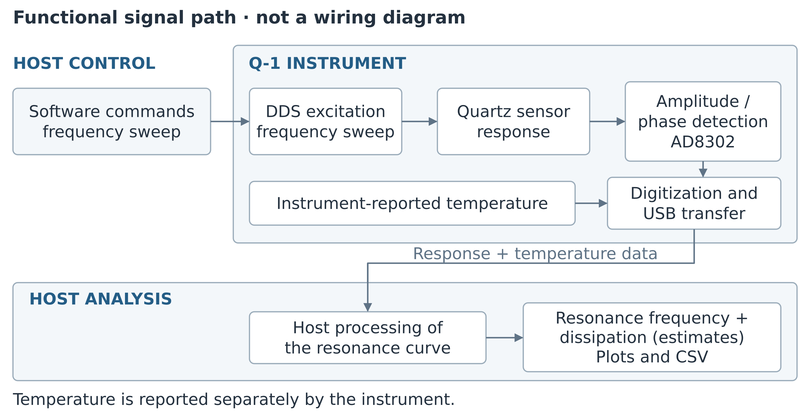
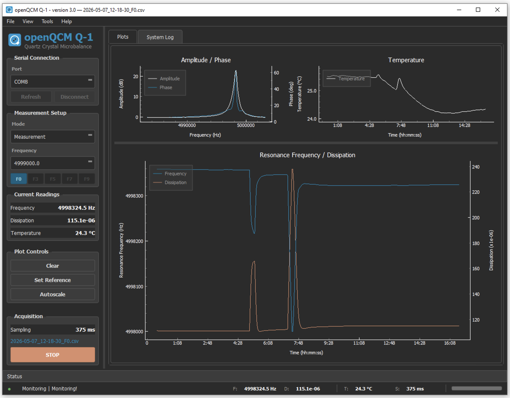
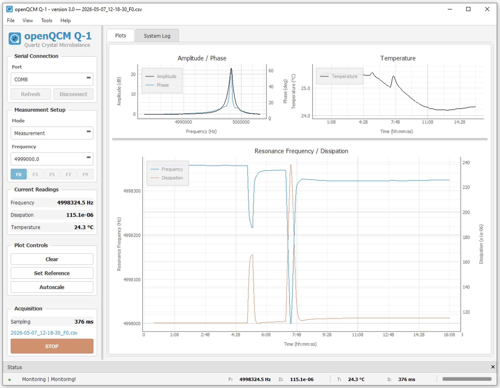
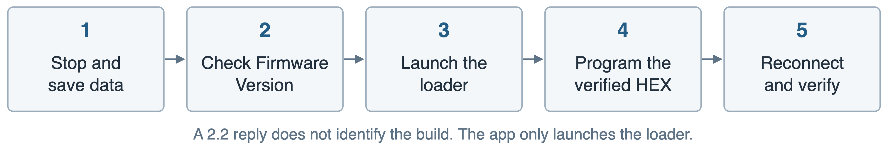

# openQCM Q-1

Software user manual

Quartz Crystal Microbalance
with Dissipation monitoring

VERSION 3.0

Installation • Peak detection • Acquisition • Data review

A practical operating reference for researchers
and technically experienced laboratory users.

Source baseline v3.0.0-rc5
Windows distribution v3.0.0-rc5
Expected firmware 2.2

Edition 1.2
12 October 2026

Software by openQCM / Novaetech S.r.l.

## Contents

Choose a procedure below or use the document bookmarks. Page numbers refer to this edition.

- [About this manual](#s1) 3

- [Introduction to the Q-1](#intro1) 4

- [Using the Q-1 as a QCM](#intro2) 5

- [1 Before you begin](#s2) 6

- [2 Install the Windows application](#s3) 7

- [3 Install from Python source](#s4) 8

- [4 Connect and identify the device](#s5) 9

- [5 Complete your first measurement](#s6) 10

- [6 Navigate the main window](#s7) 11

- [7 Use the menus](#s8) 12

- [8 Run peak detection](#s9) 13

- [9 Interpret detected resonances](#s10) 14

- [10 Acquire a measurement](#s11) 15

- [11 Set a reference and control plots](#s12) 16

- [12 Read the live plots](#s13) 17

- [13 Inspect a sweep and its parameters](#s14) 18

- [14 Review logs and use cursors](#s15) 19

- [15 Understand tracking and signal quality](#s16) 20

- [16 Locate and preserve your data](#s17) 21

- [17 Understand the file formats](#s18) 22

- [18 Maintain software and firmware](#s19) 23

- [19 Troubleshoot startup and connection](#s20) 27

- [20 Troubleshoot measurements](#s21) 28

- [21 Record a reproducible experiment](#s22) 29

- [22 Use the command line diagnostics](#s23) 30

- [23 Glossary](#s24) 31

- [24 References and provenance](#s25) 32

- [Source notes and document control](#s26) 33

- [Additional technical references](#s27) 34

Source code, release information, and figure provenance are linked in the references.

<a id="s1"></a>

## About this manual

This manual explains how to install and operate the **openQCM Q-1 Quartz Crystal Microbalance with Dissipation monitoring** software, obtain and inspect a measurement, preserve its data, and diagnose common problems. It is intended for researchers and laboratory users who understand their experiment but are new to this interface.

### Software and document scope

| **Item** | **Scope** |
| --- | --- |
| Software identity | openQCM Q-1 version 3.0 |
| Primary source baseline | Release tag v3.0.0-rc5, reviewed 12 October 2026 |
| Windows distribution | v3.0.0-rc5, a prerelease built from the same release tag |
| Expected device firmware | Version 2.2 |
| Manual edition | 1.2 • 12 October 2026 • English |
| Publisher of the software | openQCM / Novaetech S.r.l. |

The Windows package and the Python source at tag v3.0.0-rc5 are the same software revision. Procedures describe its version 3.0 interface; differences from earlier release candidates are called out where they affect operation. The Windows binary is not described as a stable production release. Neither this document nor the repository establishes performance for every computer, sensor, or experimental condition.

### How to use the guide

For a first run, follow chapters 1–5 in order. Keep chapters 8–10 nearby for peak detection and acquisition. Chapters 16–17 define the output files; chapters 19–20 provide recovery steps. The final chapters support reproducible reporting and further analysis. The introductory pages explain the instrument and QCM interpretation; chapter 18 gives the full firmware-update procedure.

**Conventions.** Bold text identifies visible controls and menu commands. Monospaced text identifies filenames or commands. “Peak detection” is the software’s resonance-finding operation, also called calibration in parts of the application; it is not a traceable metrological calibration.

**Figures.** Screenshots are authentic images supplied in the repository, showing an existing version 3.0 Windows session. Their signals and values are illustrative source captures, not acceptance limits or results generated for this manual. Hardware operation was not independently exercised for this edition.

*Source reference  [R1–R4, R12]*

<a id="intro1"></a>

## Introduction to the Q-1

The openQCM Q-1 combines a quartz-crystal sensor, frequency-sweep electronics, an embedded controller, and a USB-connected application. It follows resonance frequency and dissipation during an experiment. The application acquires, processes, displays, and stores these signals; physical interpretation is a separate step.

### The quartz crystal as a sensor

Quartz is piezoelectric: an alternating electrical excitation can drive a mechanical vibration. Near a resonance, the response depends on the crystal and what is coupled to its surface. Material added to the surface can shift the resonance, while changes in mechanical loading and energy loss can change the response width. The surrounding medium and temperature also matter.

Frequency and dissipation therefore provide complementary observations. A frequency change is not, by itself, a unique identification of mass, composition, or a molecular interaction. In liquids or with soft films, coupling to the medium and viscoelastic behavior can contribute to the measured response. Use a model appropriate to the actual sample and loading regime.



Figure 1. Functional measurement path of the Q-1 and its host software. This logical schematic identifies signal-processing roles; it is not a circuit diagram, wiring guide, or drawing of the physical sensor assembly. Temperature is a separate instrument-reported value. [R1, R7, R8, R16, R17]

### How the Q-1 interrogates the sensor

The documented instrument uses direct digital synthesis (DDS) to sweep excitation frequency and an AD8302 gain/phase detector to observe the response. The firmware returns digitized magnitude/phase readings and a temperature value over USB. The computer processes the sweep to estimate a resonance and its reported dissipation, then builds the live plots and measurement log.

Version 3.0 analyzes resonance curves rather than ring-down. Each run follows one selected resonance; other harmonics require separate runs. See chapter 1 for sensor types and quantities and chapter 13 for the implemented bandwidth convention.

*Source reference [R1, R6–R8, R16, R17]*

<a id="intro2"></a>

## Using the Q-1 as a QCM

### From sensor response to an experimental result

The purpose of a QCM experiment is to observe a reproducible change from a defined reference condition. Start with a correctly mounted sensor and a known medium, locate a credible resonance, establish a stable baseline, and then record the response to the planned intervention. Keep the original signals and the conditions needed to interpret them.

| **Stage** | **What is available** | **Interpretation boundary** |
| --- | --- | --- |
| Instrument response | Amplitude/phase samples across the commanded sweep and an instrument temperature reading | These are the inputs to the application, not a direct mass reading. |
| Sweep analysis | Processed resonance frequency, reported bandwidth, Q, and D = 1/Q | Baseline correction, smoothing, and interpolation affect the result. See chapter 13. |
| Time-series record | Processed, temporally averaged frequency, dissipation, and temperature | The CSV is the measurement record. A display reference does not alter its absolute values. |
| Physical analysis | Any mass, thickness, binding, or viscoelastic interpretation made after acquisition | The user must choose and validate the model and experimental assumptions. The GUI does not supply a validated conversion. |

### A practical experimental sequence

1. Record the sensor, medium, harmonic, software release, and firmware image provenance. Use the instrument's own instructions for assembly, sensor handling, and sample compatibility.

2. Run **Peak Detection** and inspect the detected resonance. A successful search identifies a usable candidate; it does not establish traceable frequency or mass calibration.

3. Start a short **Measurement** run. Inspect the sweep, reported bandwidth, temperature behavior, warnings, and actual CSV storage before starting the experiment.

4. Establish the reference condition using your laboratory method. If useful, set the display reference and record its time and values. No fixed stabilization time or universal drift threshold is specified here.

5. Apply the planned intervention and record its time separately. Keep frequency, dissipation, temperature, and signal-quality information together when deciding what changed.

6. Stop normally, reopen the saved CSV, and archive it with the calibration files and experiment notes. Use analysis copies and document any baseline subtraction, exclusions, or harmonic normalization.

### Limits that matter when comparing results

Temperature monitoring is not a claim of sensor-surface temperature accuracy or active temperature regulation. Sequential harmonic measurements are not simultaneous multi-overtone data. In particular, the 5 MHz F9 acquisition settings remain provisional in this source. Frequency formatting, plot scales, and example screenshots do not establish resolution, accuracy, detection limit, or a validated mass sensitivity.

For conventional QCM theory, frequency-to-mass relations apply only under their stated assumptions. This manual does not assign a universal mass conversion factor to the Q-1 outputs. Retain the reported dissipation convention and validate any comparison with a physical model or another instrument.

*Source reference [R1, R5–R8, R11, R12, R16]*

<a id="s2"></a>

## 1 Before you begin

### What the software reports

The application sweeps frequency around a quartz resonance and calculates resonance frequency and dissipation from the measured curve. It displays a frequency-domain amplitude and phase sweep alongside time histories of frequency, dissipation, and temperature. Measurement runs monitor **one selected resonance at a time**.

| **Quantity** | **Meaning** | **Units** |
| --- | --- | --- |
| Resonance frequency f | Estimated resonance from the processed sweep | Hz |
| Dissipation D | Dimensionless loss quantity, expressed as 1/Q | Dimensionless; display scaled by 10⁶ |
| Temperature | Temperature value reported by the instrument | °C |
| Sampling | Observed acquisition interval, not a user-selected rate | ms |

The software does not make a frequency shift a unique measurement of adsorbed mass. Interpretation depends on the sensor, medium, loading, temperature, and physical model. Retain frequency and dissipation together and validate any mass or viscoelastic analysis separately.

### Prepare the instrument and computer

-  Use an openQCM Q-1 connected by a working USB data cable and a supported 5 MHz or 10 MHz quartz sensor. Follow the instrument’s own handling and sample-preparation instructions.

-  Choose a writable application location with enough free disk space for the experiment and its log files. Keep the computer powered and prevent interruption according to your laboratory procedure.

-  Use only one acquisition application on the device port. Close other serial terminals and instrument applications before connecting.

-  Know which sensor and medium are installed. After changing them, repeat peak detection and inspect the result before interpreting a new measurement.

### Identify the available resonances

**F0** is the fundamental. **F3**, **F5**, **F7**, and **F9** denote odd harmonics, not five simultaneous channels. Within the 1–51 MHz detection range, a 5 MHz sensor can have F0 through F9; a 10 MHz sensor has F0, F3, and F5 within range. Availability depends on detection quality. A disabled button is not evidence that the instrument is disconnected.

*Source reference  [R1, R3, R5–R8]*

<a id="s3"></a>

## 2 Install the Windows application

The repository supplies a standalone Windows release for users who do not need a Python development environment. This edition describes release **v3.0.0-rc5**. Use that exact release identity in your experiment record.

### Install and launch

1. Open the official GitHub Releases page and select **v3.0.0-rc5**. Download the Windows release archive supplied there.

2. Extract the complete archive to a folder you can write to. Keep the files together; do not start the executable from inside the ZIP archive.

3. Run **openQCM_Q-1.exe** from the extracted folder. Allow time for the startup splash and application initialization.

4. Confirm that the main window opens. Connect the device as described in chapter 4, then complete a short verification run before relying on a long acquisition.

[Official openQCM Q-1 releases](https://github.com/openQCM/openQCM_Q-1/releases)

### Where data will appear

The application creates runtime data directories alongside the executable. Measurement CSV files are in **logged_data**. Peak-detection files are under **openQCM**. Keep this application folder writable and preserve these directories when replacing or moving the software.

### Choose the correct release

**Do not use rc3 for new measurements.** Its release notice identifies an incorrect digital-potentiometer value in the bundled firmware; rc4 and later releases correct it. A device can still report firmware version 2.2 when the firmware builds differ. Record the release package and firmware image used, rather than relying on the version string alone.

Release rc5 adds firmware and serial-number query handling for devices running firmware older than 2.2: instead of hanging, such a device is reported as having firmware that is too old, with an offer to update. With rc4 or earlier, if a legacy device hangs after a firmware or serial-number query, stop the run, reconnect or power-cycle the device as needed, and use the recovery guidance in chapter 19. Do not assume that repeatedly pressing a query command will repair the connection.

### After an update

Retain the previous release and original data until the replacement has passed a connection, peak-detection, short-acquisition, and CSV-reopen check. Software replacement and firmware flashing are separate operations.

*Source reference  [R2, R4, R9, R10, R12]*

<a id="s4"></a>

## 3 Install from Python source

Use the pinned conda environment for the source distribution. The project specifies Python **3.9.12** with historical dependency versions. A successful installation on a newer operating system is not guaranteed by the dependency list alone.

### Create the environment

1. Download or clone the repository and select the intended commit or release tag. For this manual’s baseline, use the release tag v3.0.0-rc5.

2. Install Anaconda or Miniconda through your organization’s approved process. Open a terminal or an Anaconda Prompt in the repository root, the folder containing run.py and environment.yml.

3. Create and activate the environment using the commands below. If an environment named openqcm already exists, inspect it before replacing anything.

```text
conda env create -f environment.yml
conda activate openqcm
python run.py
```

### macOS and Linux setup script

The repository also provides the setup script below. On Apple Silicon it selects x86_64 packages and checks for Rosetta 2. The script may attempt to install Rosetta with license acceptance; review that step and your local policy before running it. If an openqcm environment already exists, it asks whether to remove and recreate it.

```text
chmod +x setup_env.sh
./setup_env.sh
conda activate openqcm
python run.py
```

**Windows source setup.** Prefer the environment.yml route in Anaconda Prompt. The shell script includes Unix-style interpreter paths even in its Windows branch, so its presence does not establish a tested native Windows workflow.

### Dependencies and access

The pinned environment includes PyQt/Qt, pyqtgraph, NumPy, SciPy, pyserial, pandas, lxml, and progressbar. The shorter pip requirements list is not an equivalent complete environment; it omits progressbar used at startup. Avoid upgrading packages independently in an acquisition environment without verification.

On Linux, the account must have permission to access the device serial port. The README mentions dialout and uucp groups; the applicable group varies by system. Ask your administrator to apply the appropriate local access policy and log out and back in if membership changes. Do not run the entire application as root as a routine workaround.

*Source reference  [R1, R3, R9]*

<a id="s5"></a>

## 4 Connect and identify the device

### Connect before starting an operation

1. Plug the Q-1 into the computer with a USB data cable. Start the application.

2. In **Serial Connection**, click **Refresh** and select the device’s **Port**. Typical names are COM… on Windows, /dev/tty.usbmodem… on macOS, and /dev/ttyACM… on Linux; identify the actual device rather than choosing an arbitrary entry.

3. Click **Connect**. Check the connection indication and any message displayed by the application. The button changes to **Disconnect** when the connection is established.

4. Review the firmware check if it appears. The software expects firmware 2.2. Resolve a mismatch before relying on a measurement.

5. Use **Tools → Check Board Serial Number** if the connected firmware supports it and you need the board identifier for your records. Perform device queries while acquisition is stopped.

### Connection ownership

The application reserves the selected port while connected and hands it to the acquisition process when a run starts. Stop acquisition before disconnecting, changing the selected port, or launching a firmware updater. If connection fails, check for another Q-1 window or serial terminal that owns the same port.

### What to check before continuing

-  The selected port belongs to this instrument.

-  The connection indicator is healthy and the System Log does not show an unresolved communication error.

-  The sensor is installed and its nominal type is known.

-  The software release and firmware identity have been recorded.

**Legacy firmware caution.** From rc5, firmware and serial-number queries no longer leave a device with firmware older than 2.2 unresponsive; such firmware is reported as too old. A version string of 2.2 alone cannot identify every firmware build. If a query produces a nonresponsive device with an earlier release, recover the connection and consult the firmware guidance rather than assuming that the USB cable has failed.

### End a connection

Click **STOP** if acquisition is running. Wait until the controls return to the stopped state, then click **Disconnect**. To close the application, use **File → Quit** or the window close control and respond to any confirmation shown.

*Source reference  [R4, R6, R10, R12]*

<a id="s6"></a>

## 5 Complete your first measurement

This checklist links the essential operations into a single run. It assumes the software is installed, the sensor is prepared, and the device is connected.


Figure 2. Operating sequence. Original schematic of the documented workflow. [R4–R8, R11]

1. **Find the resonances.** Select **Peak Detection** in **Mode** and click **START**. Allow the sweep to finish. Read the completion status; a warning is a reason to inspect the result, not to proceed automatically.

2. **Check the detected peaks.** Open **Tools → Peak Data View**. Confirm a plausible fundamental and usable resonances for this sensor. If the result is poor, correct the connection or sensor condition and repeat detection.

3. **Choose the measurement.** Select **Measurement** and choose the desired available resonance with **Frequency** or the F0/F3/F5/F7/F9 buttons. Begin with a resonance whose sweep you can evaluate confidently.

4. **Start and verify.** Click **START**. The button changes to **STOP**. Wait through early processing. Check the amplitude/phase sweep, live readings, status, and the log filename in the sidebar or window title.

5. **Establish your baseline.** Let your experimental baseline stabilize. If a relative display is useful, click **Set Reference**. Record when you set it and the values used. A display reference does not change the absolute CSV data.

6. **Run the experiment.** Record interventions separately with their times. Watch signal-quality warnings as well as the frequency trace. If a peak is lost, follow chapter 20; do not interpret the warning interval as valid sample behavior.

7. **Stop and preserve.** Click **STOP**, wait for the stop to complete, and locate the CSV in **logged_data**. Open it with **File → Open Log…** and check the duration and recorded values. Copy the data and relevant calibration files into the experiment archive.

### What successful operation looks like

You should have a credible detected resonance, a visible live sweep, a sensible sampling interval, a run-specific CSV, and no unresolved warning. The label **Monitoring** indicates the application’s current state; it does not independently validate the experiment or its physical interpretation.

### Important saving behavior

**CSV logging is automatic in Measurement mode.** There is no visible CSV enable checkbox in this interface. Peak detection creates calibration and peak files instead. The filename indicator identifies the intended run file; verify the file itself after stopping.

*Source reference  [R4–R8, R11]*

<a id="s7"></a>

## 6 Navigate the main window



Figure 3. Repository-supplied version 3.0 main window in the dark theme. The image is reproduced without altering its measurement traces. [R13]

**Left sidebar:** connection, measurement selection, current readings, plot controls, sampling interval, filename, and START/STOP. **Center:** Plots and System Log tabs. **Bottom:** connection and acquisition status with compact readings.

The upper-left chart is a frequency sweep. The upper-right chart is temperature versus time. The lower chart is frequency and dissipation versus time. A splitter adjusts the space given to the upper and lower plots.

Restore hidden controls with **View → Left Panel** and **View → Status Bar**. Use **View → Theme** for light or dark appearance. The inspected source defaults to light and restores a saved theme preference.

*Source reference  [R4, R6, R13]*

<a id="s8"></a>

## 7 Use the menus

The menu bar is **File / View / Tools / Help**. The older “Data” menu described in some planning documentation is not the menu layout in this version.

| **Menu** | **Command** | **Purpose** |
| --- | --- | --- |
| File | Open Log… | Load a recorded CSV in a separate viewer. |
| File | Quit | Close the application. |
| View | Left Panel | Show or hide the sidebar. |
| View | Status Bar | Show or hide the status dock. |
| View | Cursors | Show or hide two cursors on the live frequency/dissipation plot. |
| View | Theme → Dark Theme / Light Theme | Change the interface and plot theme. |
| Tools | Measurement Parameters | Inspect current acquisition and resonance information. |
| Tools | Raw Data View | Inspect the processed current sweep and resonance fit. |
| Tools | Peak Data View | Inspect the most recent peak-detection result. |
| Tools | Check Firmware Version | Query the connected instrument firmware. |
| Tools | Check Board Serial Number | Query the board identifier where firmware supports it. |
| Help | User Guide | Open the linked manufacturer guide; this target is a v2.0 PDF in the inspected source. |
| Help | Website / Email Support | Open the manufacturer site or an email message in the configured application. |
| Help | Check for Updates… | Read the manufacturer’s published software update information. |
| Help | Download Update | Open the update destination when an update has been detected. |
| Help | About openQCM Q-1 | Show application information. |

### Keyboard and pointer reference

**Open Log:** Ctrl+O on Windows/Linux or Cmd+O on macOS. **Quit:** Ctrl+Q or Cmd+Q. Drag within a plot to pan or select a zoom rectangle, depending on the active mode; use the mouse wheel to zoom and right-click for plot options. On the frequency/dissipation plot, dragging or scrolling on one vertical axis adjusts only that axis. Hover over a control to read its tooltip.

*Source reference  [R4, R6]*

<a id="s9"></a>

## 8 Run peak detection

Peak detection makes a broad sweep, identifies resonances, and writes the calibration information used by Measurement mode. Repeat it for a newly installed sensor and whenever the previous peak list no longer represents the installed sensor or its condition.

### Procedure

1. Connect the instrument. Stop any active acquisition and check that the sensor is installed correctly.

2. Select **Peak Detection** in **Mode**. Click **START**.

3. Allow the operation to complete. The full acquisition spans **1–51 MHz** in ten sections, with a nominal **1 kHz** spacing and **50,001** saved sweep points.

4. Read the completion status and the **System Log**. If the application reports a warning or no valid peak, inspect the result before changing to Measurement.

5. Open **Tools → Peak Data View**. Compare the raw and corrected amplitude/phase curves with the peak markers. Check the detected sensor type and the fundamental.

6. Switch to **Measurement**. Review which resonances are actually selectable. Choose one valid resonance and perform a short measurement before continuing with your experiment.

### What is saved

The operation writes **PeakFrequencies.txt** and the appropriate **Calibration_5MHz.txt** or **Calibration_10MHz.txt** under the application’s openQCM data directory. These are working files reused by subsequent measurements. Archive a copy with the experiment before a later peak-detection operation replaces them.

### Evaluate the result

A plausible peak has a recognizable resonance shape and a meaningful relationship between amplitude and phase. Do not accept a frequency solely because a label is displayed. Broad, weak, clipped, or multiple nearby features warrant inspection with Peak Data View and a measurement sweep.

**Failure response.** Check the USB connection, sensor seating, and whether the sensor is a supported type. If detection remains unsuccessful, preserve the diagnostic files and System Log output for support. Repeatedly starting Measurement with a doubtful peak list is not a substitute for resolving detection.

*Source reference  [R4–R8]*

<a id="s10"></a>

## 9 Interpret detected resonances

### How the search is organized

The primary algorithm searches **1–12 MHz** for the fundamental, classifies the sensor as 5 MHz or 10 MHz, and searches windows of **±400 kHz** around expected odd harmonics. Overtone candidates are checked against phase information. The repository also contains a legacy fallback, so a successful operation does not imply that every result used the same detection path.

| **Sensor** | **Resonances within the scan** | **Practical interpretation** |
| --- | --- | --- |
| 5 MHz | F0 ≈ 5, F3 ≈ 15, F5 ≈ 25, F7 ≈ 35, F9 ≈ 45 MHz | Select only detected, credible resonances. Treat F9 cautiously; its measurement settings remain provisional and require hardware validation. |
| 10 MHz | F0 ≈ 10, F3 ≈ 30, F5 ≈ 50 MHz | F7 and F9 are outside the 51 MHz scan and are not available through this sensor path. |

The approximate frequencies above identify harmonic order, not allowed error limits or acceptance criteria. Actual resonances are shifted by the sensor and its loading. A missing overtone can have several causes; the interface alone does not identify a unique physical explanation.

### Use Peak Data View

The view shows raw amplitude and phase, their estimated baselines, corrected curves, and detected peaks. Use it to distinguish a genuine resonance from a residual baseline feature or a suspicious candidate. Keep in mind that phase screening and baseline processing are part of an algorithm, not an independent reference measurement.

### Before using an overtone

-  Confirm it is in range for the installed sensor and is enabled by the current result.

-  Start a short run and inspect its amplitude/phase curve and bandwidth in Raw Data View.

-  Check for persistent warnings, implausibly broad peaks, or a peak reaching the sweep boundary.

-  Record the harmonic order. Frequency changes from different harmonics require a consistent analysis convention; the application does not automatically make sequential runs simultaneous.

**Scientific use.** Compare overtones only with an experimental protocol that controls time, medium, and reference state. Changing an overtone requires stopping and starting a different measurement; a changing sample can therefore confound sequential comparisons.

*Source reference  [R5–R8]*

<a id="s11"></a>

## 10 Acquire a measurement

### Start a run

1. Complete successful peak detection for the installed setup. If an old calibration file was present at startup, do not assume it belongs to this sensor.

2. Select **Measurement**. Choose an available resonance using **Frequency** or the corresponding overtone button. Confirm the selection before starting.

3. Click **START**. The application uses 501 sweep samples in this mode. The visible **Sampling** value is measured timing; it is not a rate setting.

4. Wait through **Processing**, which covers approximately the first 50 sweeps while the temporal processing fills. The time required depends on actual acquisition speed.

5. Check the current sweep and **Monitoring** status. Open **Tools → Raw Data View** if you need to inspect the peak or reported bandwidth.

6. Check the run filename and the **System Log** for file errors. CSV storage is automatic. If reliable storage is essential, confirm that the run file exists and grows before proceeding with an irreversible experiment.

### During the run

The connection and measurement-selection controls are disabled during acquisition. Watch frequency, dissipation, temperature, and sampling time together. A smooth time trace can reflect averaging and is not evidence that the latest physical sweep is noise-free. The displayed and stored values are processed and temporally averaged.

Record experimental interventions in a separate notebook or event log. The CSV schema has no sample description, event marker, medium, operator, or experimental protocol field.

### Stop or change the overtone

Click **STOP** and wait for the application to finish stopping. This closes and flushes the measurement log. To measure another resonance, select it while stopped and start a new run. Save a separate reference and run record for that resonance; the interface does not record all overtones simultaneously.

### Protect a long acquisition

Live plots retain a finite history and may no longer show the start of a long experiment. The CSV is the record to preserve. Keep the application folder writable, monitor available storage, and arrange computer power and sleep behavior through the laboratory’s normal procedures. Do not unplug the device or terminate the process to finish a normal run.

*Source reference  [R4, R6–R9, R11]*

<a id="s12"></a>

## 11 Set a reference and control plots

### Display a change from baseline

1. Start Measurement and allow a suitable baseline to stabilize. Confirm that the latest frequency and dissipation values are valid.

2. Click **Set Reference**. The application stores the current frequency and dissipation values for the display and changes the button to **Clear Reference**.

3. Interpret the plotted values as changes relative to that reference. Record the time and reference values in the experiment notes if they matter to later analysis.

4. Click **Clear Reference** to return to absolute values. Starting a new run resets the reference state.

**Saved data remain absolute.** Setting or clearing a display reference does not subtract a baseline from the CSV. Reproduce the same subtraction in external analysis if you want a saved relative trace.

### Use Clear deliberately

**Clear** removes the stored live plot history and clears the frequency, dissipation, and temperature traces. It restores the plot view but does not stop acquisition, delete or restart the CSV, reset the run’s elapsed-time origin, or clear a display reference. Use **STOP** to end the run and **Clear Reference** to remove the display baseline.

| **Action** | **Effect on display** | **Effect on CSV** |
| --- | --- | --- |
| Set Reference / Clear Reference | Toggle relative or absolute frequency/dissipation | Absolute data unchanged |
| Clear | Discard live history and reset view | Logging continues in the same run |
| Autoscale / Reset Zoom | Refit axes to available data | No data transformation |
| STOP | Finish acquisition | Flush and close the run file |

### Pan and zoom

Right-click a plot for **Auto-scale**, **Reset Zoom**, **Pan Mode**, **Select Mode**, and **Show/Hide Grid**. The frequency/dissipation and temperature plots add **Lock Axes** / **Unlock Axes**, and the frequency/dissipation plot also offers cursor visibility. In Pan Mode, drag to reposition the view; the wheel zooms near the pointer. On the frequency/dissipation plot, a drag or wheel zoom inside the plot area moves the frequency and dissipation axes together, so the two traces keep their relative position; drag or scroll on the left (frequency) or right (dissipation) axis to adjust one trace alone. In Select Mode, drag a rectangle to zoom; both vertical axes are then refitted to the data in the selected time interval.

The normal minimum display ranges are **100 Hz**, **10 × 10⁻⁶** for dissipation, and **2 °C**. They apply while the axes are locked, which is the state at every start. Choose **Unlock Axes** to let the autoscale follow the data without a minimum range, for example to examine variations smaller than that range; the choice applies to all time plots and is not remembered at the next start. These are visual scaling choices, not resolution or uncertainty. Manual zoom can bypass the frequency/dissipation minimums; autoscale, reset, or Clear restores the normal view.

*Source reference  [R4, R6, R7, R11]*

<a id="s13"></a>

## 12 Read the live plots



Figure 4. Repository-supplied version 3.0 light theme with grids visible. Axis labels show the different domains and scales; these captured values are not expected results. [R13]

**Amplitude and phase:** the horizontal axis is **frequency in Hz**, with amplitude in dB and phase in degrees on separate vertical axes. **Temperature:** temperature in °C versus elapsed time. **Frequency and dissipation:** resonance frequency in Hz and dissipation scaled by 10⁶ versus elapsed time.

Use the labeled axes and legend rather than assuming that two traces sharing a horizontal position have the same units. Theme colors change some traces. Grid visibility changes presentation only. Neither a display range nor the number of shown decimal places establishes measurement precision.

*Source reference  [R4, R6–R8, R13]*

<a id="s14"></a>

## 13 Inspect a sweep and its parameters

### Measurement Parameters

Open **Tools → Measurement Parameters** to inspect the fields **Setup**, **Mode**, **Overtone**, **Freq. Value**, **Start Freq.**, **Stop Freq.**, **Range**, **Freq. Step**, and **Samples**. These describe the current selection and sweep; bounds can change when tracking recenters the sweep. Q and bandwidth are shown in Raw Data View, rather than in this parameters dialog.

### Raw Data View

Open **Tools → Raw Data View** during acquisition. This diagnostic view displays the current sweep with filtered points, a spline fit, a peak marker, and a highlighted bandwidth region. The phase trace is shown separately with a linked frequency axis. Its readout includes peak frequency, reported bandwidth, Q, and dissipation.

Despite the name, this is **processed sweep data**, not an unmodified ADC recording. Baseline subtraction, Savitzky–Golay smoothing, and interpolation are already involved. The time-series outputs additionally use a temporal averaging buffer. A single displayed sweep and a time-series value therefore need not represent identical processing stages.

### Use the diagnostic view for a decision

-  Check that the peak is inside the displayed sweep and that its shape is credible.

-  Look for clipped boundaries, missing bandwidth edges, multiple features, or a fit that does not adequately represent the visible data.

-  If warnings persist, stop and address the setup before interpreting changes as an experimental response.

-  Record the software revision and retain the calibration and log files when seeking support.

### Bandwidth and dissipation convention

The application labels its edge criterion “−3 dB” and calculates **Q = peak frequency / reported bandwidth**, followed by **D = 1/Q**. In the inspected implementation, the threshold is 0.707 times the baseline-corrected numerical magnitude values, without an intervening conversion of the dB values to linear amplitude.

Consequently, treat this as the software’s reported bandwidth convention. Do not assume it is independently validated as a conventional half-power bandwidth measurement, a ring-down measurement, or a traceable absolute dissipation result. This distinction matters when comparing values with another instrument or a physical model.

*Source reference  [R4, R6, R8, R12]*

<a id="s15"></a>

## 14 Review logs and use cursors

### Open a recorded measurement

1. After stopping the run, choose **File → Open Log…** or press Ctrl+O / Cmd+O.

2. Select the measurement CSV from **logged_data** or an archived copy.

3. Review the frequency and dissipation traces against elapsed time in the separate viewer. Use the plot context menu to rescale, reset, pan, or select a zoom region.

4. Check that the recording covers the intended duration. Preserve the original file before modifying data in a spreadsheet or analysis program.

More than one log viewer can be open. The viewer reads the expected CSV columns by position, so preserve the standard column order. It provides visualization; it does not provide the live cursor tools, cursor-selected statistics, or a separate statistics-export workflow.

### Use cursors on the live plot

1. In the main acquisition window, choose **View → Cursors**, or use the frequency/dissipation plot’s cursor context-menu action.

2. Drag the two vertical cursors to the points you want to compare. The cursors are identified as C1 and C2.

3. Read the displayed **ΔT** in seconds, **ΔF** in Hz, and **ΔD** in units of 10⁻⁶. Reposition the cursors to check the comparison.

4. Hide the cursors with the same menu control when finished.

The cursors compare the available live time-series values. Their difference is not a regression, an average over a selected interval, or an uncertainty estimate. If early data have left the live history buffer or were removed by Clear, use the CSV in an external analysis tool for a complete record.

### For quantitative postprocessing

Use **Relative_time** for the time coordinate, preserve dissipation as a dimensionless quantity, and apply any display scaling deliberately. Keep absolute values in the original record. Document the baseline interval, filtering, exclusions, harmonic normalization, and model assumptions of your separate analysis.

A filename identifies the selected harmonic but does not encode all acquisition conditions. Pair the data file with the experiment record described in chapter 21.

*Source reference  [R4, R6, R7, R11]*

<a id="s16"></a>

## 15 Understand tracking and signal quality

### Automatic recentering

During Measurement, the software follows frequency drift by recentering its sweep window when the deviation exceeds its **100 Hz** tracking threshold. The status briefly reports **Auto-Tracking #N**, and the System Log provides context. This tracking reference is distinct from the user’s **Set Reference** display baseline.

| **State or message** | **What it indicates** | **Operator response** |
| --- | --- | --- |
| Processing | Early temporal processing, about 50 sweeps | Wait; inspect the sweep if progress stalls. |
| Monitoring | Measurement path is active without the current edge warning | Continue monitoring the experiment and storage. |
| Warning | A required reported bandwidth edge is missing or the quality check fails | Inspect the sweep and sensor conditions. |
| Tracking Stopped | Tracking disabled after 10 consecutive sweeps with both edge-error flags | Do not interpret the interval as validated measurement. |
| Tracking Resumed | Five consecutive sweeps meet the recovery criterion | Inspect recovery and allow transient processing to settle. |

### What tracking safety does and does not do

After **10 consecutive bad sweeps**, tracking is disabled. It resumes after **5 consecutive good sweeps** in which at least one bandwidth edge is recovered. This is asymmetric hysteresis designed to avoid repeated switching around a marginal signal. A low reported Q can also set the edge-error flags.

**Tracking Stopped is not STOP.** Acquisition and logging can continue while automatic recentering is disabled. The recovery criterion also does not require an independent physical validation of the entire resonance. Examine the data and warnings before deciding which interval is usable.

### Recover carefully

Check sensor contact, connection, loading, and the current sweep. If the signal returns, inspect its shape and allow time for the temporal processing to recover; the retained averaging buffer can influence the initial recovery transient. If the signal remains unsuitable, click **STOP**, correct the setup, repeat peak detection where appropriate, and start a new run.

*Source reference  [R6–R8, R12]*

<a id="s17"></a>

## 16 Locate and preserve your data

### Automatic measurement logging

Each Measurement run creates a timestamped CSV under **logged_data**. The sidebar and title bar show the active filename. The normal pattern is **YYYY-MM-DD_hh-mm-ss_Fn.csv**, where Fn identifies the selected resonance, for example F0 or F3.

| **Distribution** | **Data root** | **Measurement output** |
| --- | --- | --- |
| Python source | Repository root containing run.py | logged_data/*.csv |
| Windows standalone | Folder containing openQCM_Q-1.exe | logged_data/*.csv |

The application data are stored outside the standalone program’s temporary extraction area. Copying only an executable to another folder does not move the existing experiment record with it.

### Confirm that a run is being stored

1. After starting Measurement, note the displayed filename.

2. Check **System Log** for CSV open or write errors. A moving plot alone is not proof that saving succeeded.

3. Confirm that the expected file appears in the appropriate **logged_data** directory and receives data. Avoid opening it in a program that takes an exclusive write lock during acquisition.

4. End the run with **STOP**, wait for completion, and reopen the CSV through **File → Open Log…**.

5. Archive the stopped CSV together with the relevant calibration files and experiment notes. Work on copies for analysis.

### Buffering and interruption

The writer synchronizes data to disk every 30 rows and flushes on a normal stop or close. A crash, power loss, forced termination, or abrupt device/computer shutdown can leave recent rows unwritten. Do not treat the currently visible plot as a recovery copy of the complete experiment.

### Working files are not an archive

Peak detection replaces its working peak and calibration files. Keep an experiment-specific copy before changing the sensor or running detection again. Retain the precise software package or commit and firmware image identity with the data when reproducibility matters.

The interface does not expose a standard raw-per-sweep export switch. The hidden compatibility option described in some repository notes is separate from automatic CSV logging and is not a normal user procedure.

*Source reference  [R5, R6, R9, R11]*

<a id="s18"></a>

## 17 Understand the file formats

### Measurement CSV

Files are comma-separated and contain one header row. Preserve the exact column names and order for the built-in viewer.

| **Column** | **Meaning and stored representation** |
| --- | --- |
| Date | Local acquisition date, YYYY-MM-DD. No timezone offset is stored. |
| Time | Local acquisition time, normally HH:MM:SS.mmm; fallback may omit milliseconds. |
| Relative_time | Seconds relative to the first valid temperature sample; rounded to two decimals. |
| Temperature | Processed temperature in °C, rounded to two decimals. |
| Resonance_Frequency | Processed absolute resonance frequency in Hz, rounded to two decimals. |
| Dissipation | Processed dimensionless D as a floating-point value; not pre-multiplied by 10⁶. |

For display units of 10⁻⁶, multiply stored D by **1,000,000**. For example, a dimensionless value of 0.000120 is 120 × 10⁻⁶. This is a unit-scaling example, not an experimental measurement.

CSV frequency, dissipation, and temperature values are processed and temporally averaged. Two-decimal formatting does not imply 0.01 Hz accuracy or 0.01 s physical time resolution. Sampling is not guaranteed to be uniform. Record the computer’s timezone separately and inspect actual timing for time-sensitive analysis.

### Calibration and peak files

| **File** | **Format and interpretation** |
| --- | --- |
| Calibration_5MHz.txt or Calibration_10MHz.txt | Whitespace-separated frequency in Hz, amplitude in dB, phase in degrees; normally 50,001 rows across 1–51 MHz. |
| PeakFrequencies.txt | Two columns containing duplicated peak-frequency values. Rows follow harmonic order; missing resonances may be zero. The row count can depend on sensor/detection path. |

These files live under **openQCM** in the data root. Peak Data View chooses the newest available calibration file and the shared peak list; an old file may still exist after a failed detection. Verify successful completion for the current setup instead of treating the existence of a file or a plotted curve as proof of a new calibration.

*Source reference  [R5, R6, R8, R9, R11]*

<a id="s19"></a>

## 18 Maintain software and firmware

### Check software deliberately

Use **Help → Check for Updates…** for the application's update check. In the inspected source it reads the manufacturer's news page, not the GitHub Releases API. **Download Update** becomes available when that mechanism detects an update. Compare the official repository releases separately when an rc-specific fix or a source revision matters.

The built-in **Help → User Guide** command still points to a manufacturer v2.0 PDF. Treat that guide as historical context where its interface differs from version 3.0.

### Check firmware while stopped

1. Click **STOP** if necessary and wait for acquisition to finish. Preserve the run data and keep the device connected.

2. Choose **Tools → Check Firmware Version**. This check also runs automatically after connection; a matching result is silent in the automatic check.

3. Read the returned version or communication message. The expected string is 2.2. The comparison is exact equality, not a determination of whether another version is newer or older.

4. If an update is required, obtain the correct firmware image and procedure for the actual instrument from the official release or manufacturer before accepting the updater offer.

5. Accept the offered updater launch only when ready. The application disconnects and releases the port before starting the external tool. Complete programming and verification using the following pages.

| **Result** | **What it establishes** | **What to do** |
| --- | --- | --- |
| Version 2.2 | The device returned the expected version string | Verify the firmware image or release history separately. The match does not identify the build. |
| A different valid version | The returned string differs from the expected 2.2 | Resolve compatibility and obtain the correct image before relying on a measurement. |
| Missing or invalid version reply | The application cannot identify a supported version reply; it offers an update | Legacy firmware is one possible cause. Check connection and provenance; do not infer a specific installed version from silence. |
| Communication exception | The query failed | Resolve the connection error before proceeding. A failed check is not an upload result. |

### The 2.2 version string is not enough

Do not use rc3 for new measurements. The rc3 release is deprecated because its bundled firmware used an incorrect digital-potentiometer setting. The corrected firmware bundled from rc4 onward uses a different setting, but both builds report 2.2. A matching firmware check therefore cannot prove that the corrected image is installed. Record the release package and exact firmware image used.

*Source reference [R2, R4, R6, R7, R10, R17]*

### Firmware update workflow



Figure 5. Firmware update responsibilities and verification sequence. The Q-1 application only launches an external loader after disconnecting. It does not select the HEX file, supervise programming, or verify the result. A version match must be interpreted together with the image provenance. [R2, R6, R10, R17–R19]

### Prepare the correct image and loader

The reviewed package contains openQCM_Q-1_FW_py_v2.2_T40.ino.hex under firmware_update. Its firmware source targets Teensy 4.0. Confirm that this is the correct image for the actual Q-1 hardware before programming; the filename is not permission to flash another board or an older hardware revision. Preserve the original release/commit and image with your experiment records.

| **Platform** | **Launcher in the Q-1 application** | **Scope and limitation** |
| --- | --- | --- |
| Windows | firmware_update/TyUploader.exe | External TyUploader; no image is selected. The bundled executable version is not established. |
| macOS | firmware_update/Teensy.app, launched with open | External Teensy Loader 1.52; no image is selected. Current macOS compatibility is unverified. |
| Linux | firmware_update/Teensy, opened with xdg-open | The target is absent. Obtain a manufacturer-supported procedure; this bundled launcher is incomplete. |

### When the version already reads 2.2

The matching-version dialog has no forced-update button. To replace a known rc3 image or another identified build reporting 2.2, stop acquisition, preserve data, click **Disconnect**, and open the correct bundled external loader directly. This manual route uses the same image and post-update checks.

Close other serial applications and identify the intended Q-1 before programming. Keep USB and computer power uninterrupted. Stop if hardware identity or image compatibility is uncertain. The Q-1 launch message confirms neither loader operation nor programming success.

*Source reference [R2, R6, R9, R10, R17–R19]*

### Program the firmware with the external loader

The controls below are documented by the loader's upstream project. They are not Q-1 application controls, and their appearance may differ in the bundled version. If the tool differs or reports an incompatibility, stop and use the linked upstream help or manufacturer guidance rather than guessing at a destructive action.

### Windows with TyUploader

1. Stop and disconnect the Q-1 application, or accept its offered updater launch after preparing the correct image. Open TyUploader.exe from the intended release's firmware_update folder if using the manual route.

2. Identify and select the intended device in the loader's board selector. Do not select a board solely because it is the first entry.

3. Click **Upload**. The upstream implementation opens the file dialog titled **Select a firmware for this device**.

4. Select the verified Q-1 HEX file for the matching hardware. Confirming that file selection starts the upload in the documented upstream implementation; it is not a separate review-only step. Recheck the filename and target before confirming.

5. Wait for the loader to finish and inspect its result. Do not disconnect USB or treat the Q-1 application's launch message as a programming-success indication. If the loader fails, follow the recovery guidance on the next page.

These steps follow the official TyUploader source at the revision cited in [R18]. They do not establish the version or hardware-tested behavior of the bundled executable. The presence of a **Reset** control is not an instruction to press it during a transfer.

### macOS with Teensy Loader

1. Stop and disconnect the Q-1 application, or accept its updater launch. Open the intended release's Teensy.app directly when a manual launch is needed.

2. Choose **File → Open HEX File** and select the verified Q-1 HEX image. Use the Q-1 file; example blink programs in upstream tutorials are not instrument firmware.

3. Make the intended board available in programming mode as required by the loader and the instrument's supported access procedure. The Teensy 4.0 Program button enters programming mode; it is not a normal reset button. Do not infer how to open the Q-1 enclosure or reach its board from this software manual.

4. In the upstream manual-mode procedure, choose **Operations → Program** and wait for **Download Complete**. Keep the connection intact while programming.

5. Choose **Operations → Reboot** to start the programmed firmware, then perform the reconnection and measurement checks on the next page.

These are PJRC's generic Teensy Loader steps, not a hardware-tested Q-1 service procedure. The bundled macOS application is version 1.52. If the operating system blocks it or the board is not recognized, consult official loader/manufacturer guidance; do not bypass a security warning or substitute an arbitrary binary.

*Source reference [R6, R10, R17–R19]*

### Verify the update and recover safely

### Reconnect and verify before measuring

1. Confirm that the external loader reports successful programming and that the firmware has restarted according to that loader's procedure. Close the loader when finished.

2. Return to the Q-1 application. Click **Refresh**, identify the device's current Port, and click **Connect**. USB enumeration can change the port name.

3. While stopped, use **Tools → Check Firmware Version**. Confirm the expected 2.2 reply and record the exact release/HEX provenance; the reply alone cannot distinguish the rc3 and corrected builds.

4. Repeat **Peak Detection** and inspect the result. Start a short **Measurement** run and check the sweep, frequency, dissipation, temperature, warnings, and recorded filename.

5. Click **STOP**, wait for normal completion, and reopen the CSV with **File → Open Log…**. Preserve the successful verification record before starting a consequential experiment.

This is an operational verification sequence. It does not replace a validated laboratory acceptance test or establish a measurement uncertainty. Hardware flashing was not independently exercised for this edition.

### If an update cannot be completed

- Loader does not open: check that the complete intended package is extracted and that its firmware_update contents are present. Read the displayed error. On Linux the expected target is absent from this source tree; obtain the supported manufacturer procedure.

- No device in the loader: verify the USB data connection, stop other applications that may own the port, and use only the board's documented programming-mode procedure. If physical access is unclear, contact the manufacturer.

- **Upload** fails or is interrupted: retain the loader's exact error and image identity. Do not start a measurement on the assumption that programming partly succeeded. Consult the loader/manufacturer recovery instructions before retrying the same verified image.

- Application cannot reconnect: wait until programming has finished and the loader has restarted the firmware, close the loader, refresh the port list, and reconnect. Never unplug or power-cycle the instrument while the loader is actively writing.

- Device becomes unresponsive after a version or serial query: stop and recover the connection, reconnecting or power-cycling only when no programming is in progress. Release rc5 fixes the legacy query handling; rc4 and earlier do not include this fix. Repeated query clicks are not a recovery method.

### Identifiers and release history

**Check Board Serial Number** can report a stored board identifier when supported. If the device reports **NO_SERIAL**, contact support rather than inventing or programming a replacement identifier. Keep release and firmware-image provenance because different firmware builds can share the reported 2.2 version.

The rc4 and rc5 Windows packages correct the deprecated rc3 bundled firmware setting; the legacy-firmware query fix is present from rc5. Software “up to date” and “matches this manual's source release” are different checks.

*Source reference [R2, R6, R10, R12, R17–R19]*

<a id="s20"></a>

## 19 Troubleshoot startup and connection

### Application will not start

For a standalone installation, extract the complete release archive into a writable folder and launch the executable from there. For source, activate the intended conda environment and run **python run.py** from the repository root. Capture the complete error output before changing packages.

If a module is missing, compare the environment with **environment.yml**. In particular, the unpinned pip requirements do not include progressbar used by the application. Prefer rebuilding the supplied isolated environment over mixing unrelated package upgrades into a working laboratory installation.

### No usable serial port

1. Check that the instrument is attached with a USB data cable and is visible to the operating system.

2. Click **Refresh** and identify the correct device port. Recheck after reconnecting the cable; the port name can change.

3. Close other applications that may own the port, including another Q-1 instance.

4. On Linux, check the account’s serial-device permissions with an administrator. After a group change, log out and back in.

5. Try the connection again. If it still fails, record the port name, operating system, error message, and firmware/software history for support.

### Port busy or locked

Use the owning application’s normal stop and disconnect controls. A port reservation prevents competing programs from communicating with the same instrument. Do not delete lock files blindly or repeatedly launch new application instances as a workaround.

### Device stops responding after a query

Stop the operation and reconnect or power-cycle the device if necessary. Release rc5 includes a fix for legacy firmware interpreting version/serial queries incorrectly; rc4 and earlier do not include this change. Preserve the exact version and symptoms and consult the official update guidance.

### Cannot find a control

Restore **View → Left Panel** or **View → Status Bar**. Stop acquisition before changing its mode or resonance. There is no visible sample-count or CSV-export checkbox in this layout. If instructions show a Data menu or a right-hand readings panel, check whether they describe an older interface.

*Source reference  [R3, R4, R6, R9, R12]*

<a id="s21"></a>

## 20 Troubleshoot measurements

| **Symptom** | **Checks and recovery** |
| --- | --- |
| Peak Detection Warning or no valid peak | Check supported sensor type, seating and USB connection. Inspect System Log and Peak Data View. Reconnect and retry after an empty-buffer/acquisition error. Do not reuse old files as if detection just succeeded. |
| An overtone is unavailable | Check the sensor type and detected peak list. F7/F9 are outside the 10 MHz sensor scan. A zero/missing result is not an enabled valid resonance. Inspect the detection result before retrying. |
| Missing lower or upper bandwidth edge | Inspect Raw Data View for the peak shape and sweep boundary. Check changing loading/contact and reported quality. Resolve persistent warnings before quantitative interpretation. |
| Tracking Stopped | Acquisition may still run. Inspect the signal, correct the cause, and watch for five consecutive recovery sweeps. If unsuitable, STOP and repeat detection after correcting the setup. |
| Unexpected change immediately after recovery | Allow for retained temporal-processing values. Inspect the recovered sweep and annotate the affected interval; automatic resumption does not validate every sample. |
| CSV missing or incomplete | Check the displayed filename, correct data root, write permissions, storage, and System Log errors. Use STOP to flush. A plot can continue despite a file-writing problem. |
| Sampling time varies | Treat Sampling as observed timing. Inspect CSV timestamps and computer workload. Do not assume a guaranteed rate or that all timing spikes are harmless. |
| Plots appear flat or exaggerated | Check units, reference state, manual zoom, and minimum display ranges. Use Autoscale or Reset Zoom; choose Unlock Axes to remove the minimum ranges. Scaling is not measurement resolution. |

### When to start a new run

Stop and create a new measurement after changing the selected overtone, correcting an unsuitable sensor setup, or repeating peak detection. Preserve the failed or interrupted file and annotate why it was excluded instead of silently replacing the experimental record.

### What to send to support

Provide the software release or commit, operating system, Python environment if applicable, firmware version and image provenance, board identifier if available, steps to reproduce, exact message, relevant System Log output, and suitable screenshots or data. Review files for confidential experimental content before sharing them.

*Source reference  [R1, R4–R8, R11, R12]*

<a id="s22"></a>

## 21 Record a reproducible experiment

The CSV captures numerical results, but not all conditions needed to interpret or reproduce them. The following record is a recommended laboratory practice rather than a built-in application form.

| **Record** | **Information to retain** |
| --- | --- |
| Software | Version 3.0 plus exact release/tag or source commit; operating system and source environment if used. |
| Instrument | Board identifier, reported firmware version, firmware image or release package used. |
| Sensor and setup | Sensor nominal frequency, identifier/batch if relevant, mounting, medium, experimental conditions, and chosen harmonic. |
| Detection | Date/time of successful peak detection, calibration file, peak list, and any warnings or missing resonances. |
| Measurement | CSV filename, start/stop times, computer timezone, chosen overtone, reference values/time, and relevant sweep settings. |
| Events and exceptions | Interventions, temperature changes, tracking warnings, connection interruptions, excluded intervals and reasons. |
| Analysis | Original-file checksum if used locally, processing version, baseline interval, transformations, physical model and uncertainty treatment. |

### Keep observation separate from interpretation

Describe what the application recorded before assigning a physical cause. A frequency shift, dissipation change, or missing peak can depend on multiple aspects of the setup. The software does not validate a mass model, distinguish all loading mechanisms, or establish an uncertainty budget for you.

When comparing sensors or overtones, report how the frequencies were normalized and how time differences between sequential runs were handled. Use the stated bandwidth convention when comparing dissipation with another instrument.

### Minimum verification after a change

After a software, firmware, environment, or material setup change, perform a connection check, successful peak detection, a short acquisition with a credible sweep, and a stopped CSV reopen. Define any quantitative acceptance thresholds in your own validated laboratory method; the repository screenshots do not supply such thresholds.

*Source reference  [R1–R3, R5–R12]*

<a id="s23"></a>

## 22 Use the command line diagnostics

The source repository includes optional diagnostic scripts. They are tools for experienced users working with saved files, not prerequisites for ordinary GUI operation. All three scripts below import **matplotlib**, which is not required by the GUI and is not listed in its pinned environment. Configure the necessary analysis dependencies separately. The standalone Windows application does not establish a ready-to-use Python environment for these scripts.

### Inspect a saved peak detection

```text
python tools/peak_detection_analyzer.py \
  openQCM/Calibration_5MHz.txt
```

The analyzer replays peak detection on a saved calibration file and creates a diagnostic plot. Use the file matching the actual experiment. Treat its result as an algorithmic diagnostic, not a new instrument acquisition.

### Inspect one overtone window

```text
python tools/overtone_analyzer.py \
  openQCM/Calibration_10MHz.txt 3
```

This example examines the third overtone of a saved 10 MHz calibration file. It helps inspect the magnitude/phase candidates and screening conditions around the expected harmonic. Replace both the input file and harmonic with the values relevant to your case.

### Inspect acquisition timing

```text
python tools/sampling_time_monitor.py \
  logged_data/your_measurement_F0.csv
```

Use an actual measurement filename to inspect recorded sampling-time behavior. Interpret timing in the context of the CSV’s timestamp and rounding conventions. A distribution of observed intervals does not prove uniform physical sampling.

### Run safely on a copy

1. Stop acquisition and make an analysis copy of the relevant files.

2. Open a terminal at the source-repository root and activate an appropriate environment.

3. Inspect the script’s usage and required packages before running it. If plotting dependencies are absent, configure an analysis environment separately from the acquisition environment.

4. Retain the original inputs and record the script revision with any derived figure or interpretation.

The backslash line continuations above are for a POSIX shell; enter each command on one line in Windows Command Prompt. The separate qcm_data_analyzer developer script is not described here as a packaged GUI feature.

*Source reference  [R3, R14]*

<a id="s24"></a>

## 23 Glossary

| **Term** | **Meaning in this guide** |
| --- | --- |
| Amplitude | The instrument-derived sweep magnitude displayed in dB. |
| Baseline correction | Subtraction of an estimated background from the sweep before further processing. |
| Calibration / Peak Detection | The software’s broad scan and resonance-finding operation; not a claim of traceable calibration. |
| Dissipation D | Software-reported dimensionless loss estimate, calculated as 1/Q. Display values commonly use a 10⁻⁶ scale. |
| F0 | Fundamental resonance selected for measurement. |
| F3 F5 F7 F9 | Third, fifth, seventh, and ninth harmonic selections where supported and detected. |
| Frequency sweep | A sequence of measurements across a frequency interval, used to locate and evaluate a resonance. |
| Overtone | An odd harmonic of the fundamental used by this application. |
| Peak Data View | Diagnostic view of saved peak-detection curves and detected resonances. |
| Q | Software-reported peak frequency divided by its reported bandwidth. See chapter 13 for the convention and limitation. |
| Raw Data View | Live processed-sweep diagnostic, including filtered points and a fitted curve. |
| Reference | User-selected baseline for relative display; distinct from the auto-tracking reference and absolute CSV values. |
| Sampling | Observed sweep/acquisition timing shown in milliseconds. |
| Savitzky–Golay filtering | Local polynomial smoothing used in processing the frequency sweep. |
| Spline | Smooth interpolating/fitted curve used to estimate resonance features. |
| Tracking | Automatic recentering of the sweep window as the resonance drifts. |
| Trimmed mean | Temporal averaging that removes a fraction of extreme values before computing the mean. |

*Source reference  [R1, R5–R8, R11]*

<a id="s25"></a>

## 24 References and provenance

The following sources document the version covered by this edition. Repository links are pinned to the reviewed release tag unless a release or comparison is explicitly named. Implementation and current release evidence take precedence over conflicting historical planning text.

**Reviewed source release**
v3.0.0-rc5

[\[R1\] Project overview and operator entry points](https://github.com/openQCM/openQCM_Q-1/blob/v3.0.0-rc5/README.md)

README.md; product identity, launch instructions, platform notes, support and citation pointers.

[\[R2\] Windows v3.0.0-rc5 release](https://github.com/openQCM/openQCM_Q-1/releases/tag/v3.0.0-rc5)

[Changes between rc4 and rc5](https://github.com/openQCM/openQCM_Q-1/compare/v3.0.0-rc4...v3.0.0-rc5)

Release status, deprecated rc3 firmware correction, and the changes introduced in rc5.

[\[R3\] Pinned source environment](https://github.com/openQCM/openQCM_Q-1/blob/v3.0.0-rc5/environment.yml)

[Source setup script](https://github.com/openQCM/openQCM_Q-1/blob/v3.0.0-rc5/setup_env.sh)

[Alternative pip requirements](https://github.com/openQCM/openQCM_Q-1/blob/v3.0.0-rc5/requirements.txt)

Installation commands and dependency limitations are also cross-checked against README.md and CONTRIBUTING.md.

[\[R4\] Interface definitions and diagnostic viewers](https://github.com/openQCM/openQCM_Q-1/blob/v3.0.0-rc5/openQCM/ui/mainWindow_ui.py)

[\[R5\] Peak detection and calibration output](https://github.com/openQCM/openQCM_Q-1/blob/v3.0.0-rc5/openQCM/processors/Calibration.py)

[\[R6\] Main window behavior and device queries](https://github.com/openQCM/openQCM_Q-1/blob/v3.0.0-rc5/openQCM/ui/mainWindow.py)

[\[R7\] Application constants and processing settings](https://github.com/openQCM/openQCM_Q-1/blob/v3.0.0-rc5/openQCM/core/constants.py)

[\[R8\] Sweep processing and tracking](https://github.com/openQCM/openQCM_Q-1/blob/v3.0.0-rc5/openQCM/processors/Serial.py)

These implementation references support the visible controls, procedures, units, processing conventions, warnings, and version-specific behavior described in chapters 4–20.

<a id="s26"></a>

## Source notes and document control

[\[R9\] Persistent data locations](https://github.com/openQCM/openQCM_Q-1/blob/v3.0.0-rc5/openQCM/common/resources.py)

[\[R10\] Firmware and update resources](https://github.com/openQCM/openQCM_Q-1/tree/v3.0.0-rc5/firmware_update)

[\[R11\] Automatic CSV logging and temporal data handling](https://github.com/openQCM/openQCM_Q-1/blob/v3.0.0-rc5/openQCM/core/worker.py)

[\[R12\] Known validation work and limitations](https://github.com/openQCM/openQCM_Q-1/blob/v3.0.0-rc5/TODO.md)

[Development and release history](https://github.com/openQCM/openQCM_Q-1/blob/v3.0.0-rc5/CHANGELOG.md)

[\[R13\] Authentic repository screenshot assets](https://github.com/openQCM/openQCM_Q-1/tree/v3.0.0-rc5/docs/images)

Figure 2 is an original procedural schematic based on the documented workflow. Figure 3: screenshot_dark.png. Figure 4: screenshot_light_grid.png. The two screenshots are original repository assets from a historical version 3.0 Windows session. They are retained as illustrations without creating new measurement data or a new application capture. Figures 1 and 5 are original logical schematics of the documented measurement and firmware workflows; they are not physical wiring diagrams or instrument screenshots.

[\[R14\] Optional diagnostic scripts](https://github.com/openQCM/openQCM_Q-1/tree/v3.0.0-rc5/tools)

[\[R15\] Software citation metadata](https://github.com/openQCM/openQCM_Q-1/blob/v3.0.0-rc5/CITATION.cff)

[Software GPL v3 license](https://github.com/openQCM/openQCM_Q-1/blob/v3.0.0-rc5/LICENSE)

<a id="s27"></a>

## Additional technical references

[\[R16\] Q-1 instrument and QCM principles](https://openqcm.com/about-openqcm-q-1)

[Manufacturer introduction to QCM technology](https://openqcm.com/technology)

[Loading models and their interpretation limits](https://openqcm.com/introducing-the-openqcm-advanced-calculator-three-models-one-click-zero-installation.html)

[\[R17\] Q-1 Teensy 4.0 firmware source](https://github.com/openQCM/openQCM_Q-1/blob/v3.0.0-rc5/firmware/openQCM_Q-1_FW_py_v2.2_T40/openQCM_Q-1_FW_py_v2.2_T40.ino)

[Bundled Q-1 firmware image](https://github.com/openQCM/openQCM_Q-1/blob/v3.0.0-rc5/firmware_update/openQCM_Q-1_FW_py_v2.2_T40.ino.hex)

[Deprecated rc3 release notice](https://github.com/openQCM/openQCM_Q-1/releases/tag/v3.0.0-rc3)

[\[R18\] TyTools and TyUploader official project](https://koromix.dev/tytools)

[TyUploader v0.9.7 upload action and file confirmation](https://github.com/Koromix/tytools/blob/b97419263cb19785df1f17d23f520717b4fc6f49/src/tyuploader/uploader_window.cc#L86-L97)

[\[R19\] PJRC Teensy Loader manual for macOS](https://www.pjrc.com/teensy/loader_mac.html)

[Current PJRC loader guidance](https://www.pjrc.com/teensy/loader.html)

[Teensy 4.0 programming and Program button](https://www.pjrc.com/store/teensy40.html)

The manufacturer pages support the general QCM introduction. The loader sources support external-tool procedures, not a claim that the bundled binaries or a particular Q-1 were tested for this edition. Original screenshots remain unchanged; the new schematics depict logical functions and operator responsibilities.

### Document revision

| **Edition** | **Date** | **Description** |
| --- | --- | --- |
| 1.0 | 05 October 2026 | Initial English software user manual, aligned to source snapshot 8490b3164610 and separately scoped to the rc4 Windows distribution. |
| 1.1 | 06 October 2026 | Added the Q-1 and QCM introduction, expanded firmware checks, external-loader procedures and recovery, and added technical schematics. Word, PDF, and Markdown remain synchronized. |
| 1.2 | 12 October 2026 | Updated for release v3.0.0-rc5: Lock Axes / Unlock Axes in the plot context menu, linked frequency/dissipation pan and zoom, the legacy-firmware query fix now included in the release, and references pinned to tag v3.0.0-rc5. |

This manual is an independently prepared operating reference for the identified software. It is not a manufacturer certification, regulatory approval, performance specification, or assertion of formal standards compliance. The software is published by openQCM / Novaetech S.r.l. under its stated GPL v3 license.

### Support and software citation

For software issues, use the project’s issue tracker or the manufacturer contact. Include the evidence listed in chapter 20. Cite the software using its repository citation metadata and add the exact version or commit used for your work.

[openQCM Q-1 issue tracker](https://github.com/openQCM/openQCM_Q-1/issues)

[openQCM manufacturer website](https://openqcm.com/)
